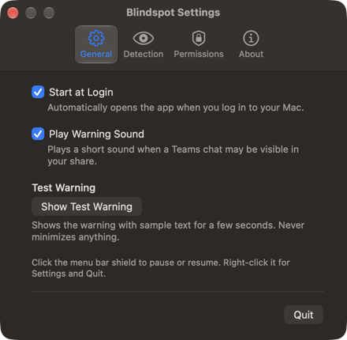
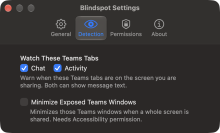
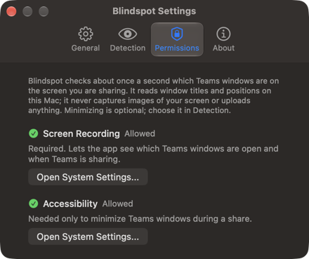

# Blindspot

A macOS menu bar app that warns you when a Microsoft Teams chat may be visible in your Teams screen share, and can minimize it for you.

If a Teams Chat or Activity window is on the screen you share, everyone in the meeting can read it.
Blindspot checks about once a second, so it notices within a second or so, then:

- plays a warning sound and turns its menu bar shield red,
- shows a red banner on a screen you are *not* sharing,
- and, if you turn on minimizing, minimizes those Teams windows when you share a whole screen.

  
  
  

## Get it

- **Download:** grab `Blindspot.zip` from [Releases](../../releases), then follow [Install](docs/INSTALL.md).
  macOS blocks the first launch because the app is not signed by Apple; the guide covers the one-time fix.
- **Build it yourself:** see [Building](docs/BUILDING.md).
  Recommended if you use it daily, since your permissions then usually survive updates.

Needs macOS 13 or later on Apple silicon, and the new Microsoft Teams for Mac.

## Use it

- **Left-click** the shield to pause or resume.
  Filled means running, outline means paused or checks are off.
- **Right-click** for Settings and Quit.
- Minimizing is off until you turn it on in **Settings > Detection**.
  If you never changed that setting in an earlier version, it is now off.
- To see what a warning looks like, click **Show Test Warning** in **Settings > General**.
  It shows the banner with sample text for a few seconds and never minimizes anything.
  It works only while checks are running and no Teams share is detected.

## What the shield says

Right-click the shield to read its status, or hold the pointer over it.

| Status | Shield |
|---|---|
| Paused | Outline |
| Checks disabled: no Teams tabs selected | Outline |
| Needs Screen Recording permission | Lock |
| Unable to check Teams sharing | Orange |
| No Teams share detected | Filled |
| Sharing; no watched Teams windows detected in the shared area | Check mark |
| Teams Chat may be visible in your share | Red |
| Teams Activity may be visible in your share | Red |

For whole-screen shares, when minimizing is on and an attempt can't be made or fails, a second line under the warning says why:

- Not minimized: needs Accessibility permission
- Not minimized: more than one matching Teams window
- Not minimized: the Teams window changed
- Not minimized: couldn't read the Teams window
- Not minimized: Teams did not respond

The warning stays in place in every case.

## Privacy

- Blindspot reads window titles and positions on your Mac.
  It never captures images of your screen, uploads anything, or uses the network.
- It stores its settings in macOS user defaults, and Start at Login as `~/Library/LaunchAgents/com.abhichandra.blindspot.plist`.
- Its log messages never include window titles.
- Running the app from Terminal with `--once` prints the current state to the terminal; when a Teams window is exposed, that includes its title.

## Known limits

- Teams only.
  Shares from Zoom, Slack, or a browser are not detected.
- A chat fully hidden behind another window still triggers the warning, so it says the chat *may* be visible.
- When you share a single window, Blindspot warns if a watched Teams window covers at least half of it, but never minimizes anything, unless it is treated as a whole-screen share (see below).
- A shared window that fills almost a whole screen may be treated as a whole-screen share.
- It minimizes only a Teams window it can clearly identify by title and position.
  For whole-screen shares, when minimizing is on and an attempt can't be made or fails, the menu says why.
- With one screen there is nowhere safe for the banner, so you get the sound and red icon only.
- It relies on how the new Teams names its windows ("Chat | ..." and "Activity | ..." in English), not a documented API, so a Teams update or another language could break detection.
- Teams notification pop-ups are separate from the Chat and Activity windows and are not detected.
  Teams can turn them off while you share: see [Change your status in Microsoft Teams](https://support.microsoft.com/en-us/teams/notifications-settings/change-your-status-in-microsoft-teams) for **Set my status to Do not disturb when I'm sharing my screen**.
- Sharing a single window, and automatic minimizing, have not been tested on a real call yet.
